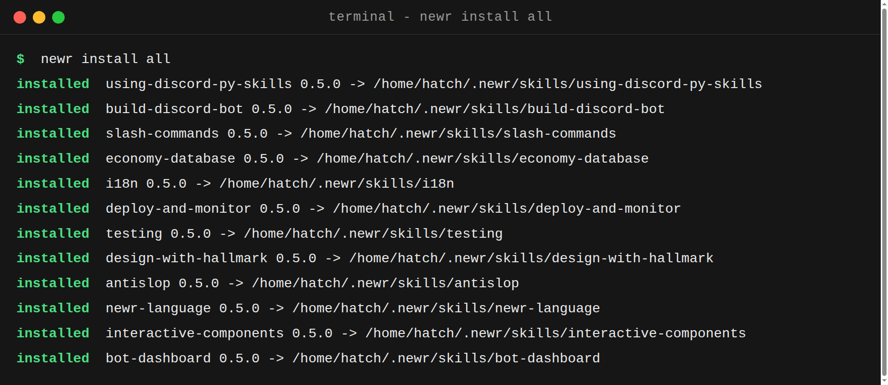
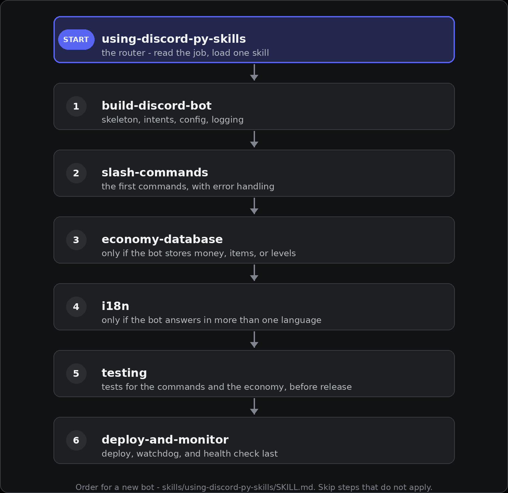
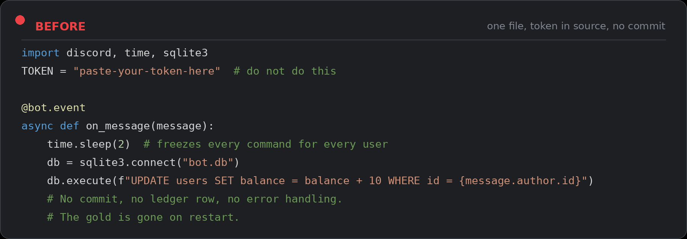
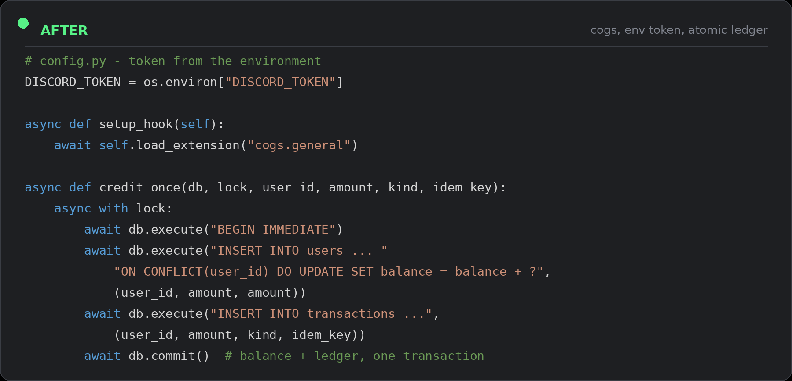

<p align="center">
  <a href="assets/banner.png"></a>
</p>

<div align="center">

[](https://github.com/drewdestar/discord-py-skills)
[](https://www.python.org/)
[](https://discordpy.readthedocs.io/)
[](LICENSE)

# discord-py-skills

### Agent skills and a production starter kit for building Discord bots with discord.py.

**Seven skills, one router, one installer.** The router reads the job,
loads the one skill the job needs, and each skill teaches one job:
scaffolding, slash commands, a SQLite economy that cannot create
money, honest i18n, deploys that restart themselves, and tests that
can fail.

`newr install all`

[Before and after](#before--after) · [Install](#install-with-newr-like-homebrew) · [Skills](#skills) · [newr language](#write-a-bot-in-the-newr-language)

</div>

Works with 31 AI coding agents, from Claude Code and Codex to
Qwen Code, Kimi Code, Kiro, JetBrains Junie, Muse Code, and Grok
Build, plus Aider via a `CONVENTIONS.md` digest. See
[docs/AGENTS.md](docs/AGENTS.md) for the full list, including the
agents with no skill system (Meta AI, DeepSeek chat, Qwen chat,
Google Jules) that this pack honestly cannot install into.

## Install with newr (like Homebrew)

`newr` is the package manager for this pack. Install it once, then
install skills by name:

```bash
curl -fsSL https://raw.githubusercontent.com/drewdestar/discord-py-skills/main/install.sh | sh
newr search
newr install slash-commands
newr install all               # all seven skills
newr install starter-bot       # runnable starter bot into ./starter-bot
```

<p align="center">
  <a href="assets/terminal-install.png"></a>
</p>

Real output of `newr install all` (v0.4.0). Skills install to
`~/.newr/skills/<name>`; `NEWR_HOME` overrides the prefix.

| Command | What it does |
|---|---|
| `newr search [query]` | List installable packages |
| `newr info <package>` | Show a package's details and install state |
| `newr install <pkg>...` | Install packages (`all` = the seven skills) |
| `newr uninstall <pkg>...` | Remove installed skills |
| `newr list` | Show installed skills |
| `newr update` | Refresh the registry and update installed skills |
| `newr version` | Print the newr version |
| `newr agents` | List supported agents and their skill dirs |

Skills install to `~/.newr/skills/<name>` (`NEWR_HOME` overrides the
prefix). Templates install into the current directory. No account, no
token, no build step. `newr` is one Python file, standard library only.

Install straight into an agent instead:

```bash
newr install --agent claude-code all    # Claude Code
newr install --agent codex,cursor all   # several agents at once
newr install --agent auto all           # every agent detected here
newr install --agent all all            # every known agent
newr install --agent copilot --project testing  # into this project
```

## Install with npx (no install step)

No install, no clone. Needs Node.js 18 or newer, Python 3.10 or
newer, and git, on macOS or Linux:

```bash
npx -y github:drewdestar/discord-py-skills install all
npx -y github:drewdestar/discord-py-skills install --agent claude-code all
```

This runs `newr` straight from the repo. The `newr` package is not
published to the npm registry yet, so `npx newr` on its own does not
work; use the `github:` form above.

Claude Code can also install the pack as a plugin:

```
/plugin marketplace add drewdestar/discord-py-skills
/plugin install discord-py-skills@discord-py-skills
```

## Install by hand

Copy the `skills/` folder into your agent's skills directory. The
recommended way is `newr install --agent <name> all` (see above);
by hand, the directories are:

| Agent | Copy to |
|---|---|
| Claude Code | `~/.claude/skills/` |
| Codex | `~/.agents/skills/` (older installs also read `~/.codex/skills/`) |
| Cursor | `~/.cursor/skills/` |
| Windsurf / Devin Local | `~/.config/devin/skills/` |
| GitHub Copilot | `~/.copilot/skills/` |
| Gemini CLI | `~/.gemini/skills/` |
| OpenCode | `~/.config/opencode/skills/` |
| Kilo Code, Zed | `~/.agents/skills/` |
| Cline | `~/.cline/skills/` |
| Aider | no skill system; copy `aider/CONVENTIONS.md` and add it to `read:` in `.aider.conf.yml` |

Full matrix, including project-scope directories, is in
[docs/AGENTS.md](docs/AGENTS.md).

Then ask your agent to build a bot. It picks the skill that matches the
job: `using-discord-py-skills` routes the work first,
`build-discord-bot` for scaffolding, `slash-commands` for commands,
`economy-database` for currency, `i18n` for languages,
`deploy-and-monitor` for running it, `testing` for proving it works.

## Skills

| Skill | What it covers | Use when |
|---|---|---|
| `using-discord-py-skills` | Routes any bot job to the right skill, in the right order | starting bot work, or unsure which skill applies |
| `build-discord-bot` | Scaffold a correct bot: intents, cogs, async setup, config from the environment, logging | "build me a bot", "my bot does not answer" |
| `slash-commands` | Slash commands, groups, checks, autocomplete, cooldowns, error handling that answers the user | "add a /balance command", "interaction failed" |
| `economy-database` | SQLite economy: WAL mode, atomic transfers, idempotency keys, ledger, backups | "add currency", "gold duplicated" |
| `i18n` | Multi-language bots: per-user locale, fallback chain, translation pitfalls | "speak Indonesian", "wrong language replies" |
| `deploy-and-monitor` | systemd service, watchdog restarts, log rotation, health checks, safe restarts | "keep my bot online", "my bot keeps dying" |
| `testing` | Unit tests for logic, mocked interactions for commands, async tests with pytest-asyncio | "write tests", "the test passes but the bot is broken" |

## How the router works

`using-discord-py-skills` does no bot work itself. It reads the job,
loads the one skill the job needs, and for a new bot it runs them in
this order:

<p align="center">
  <a href="assets/routing.png"></a>
</p>

Skip steps that do not apply. Do not add an economy to a bot that has
no currency, and do not add i18n to a bot with one language.
Full route table: `skills/using-discord-py-skills/SKILL.md`.

## Write a bot in the newr language

`newr` has its own small language for defining a bot. A `.newr`
file is not a general-purpose programming language: it describes a
bot (its name, its slash commands, and two simple events), and
`newr build` compiles it into a runnable discord.py bot. Full
syntax in [docs/NEWR-LANG.md](docs/NEWR-LANG.md).

```newr
bot "HelloBot":
  description: "A friendly bot that answers in plain words"

command ping:
  description: "Answer with pong"
  reply: "Pong! Hello {user}"

command greet:
  description: "Greet someone in this server"
  reply: "Hello {user}, welcome to {guild}!"
  ephemeral: true

event ready:
  log: "{bot} is online"

event member_join:
  reply: "Welcome to {guild}, {user}!"
```

```bash
newr build hello.newr            # writes hello.py next to it
newr build hello.newr -o bot.py  # writes bot.py instead
newr build --check hello.newr    # parse and compile, write nothing
DISCORD_TOKEN=... python hello.py
```

The generated bot follows the same rules as the starter bot:
slash commands on the tree synced in `setup_hook`, intents
derived from the source (members intent only when a
`member_join` event exists), the token from `DISCORD_TOKEN` only,
and command errors answered instead of failing silently. A
working example is in [examples/hello.newr](examples/hello.newr)
with its generated output in
[examples/hello.py](examples/hello.py). If the bot needs logic
the language cannot say (economy, arguments, buttons), write
Python with the skills instead.

## Quality bar

Every skill enforces the same bar, written up in
[docs/QUALITY.md](docs/QUALITY.md): no em dash in anything the bot
sends, no invented numbers, every command answers, every feature has
a one-line reason, and nothing is called done until it is verified
live in Discord. A green test suite is not proof the bot answers.

## Before / after

The same bot, written twice: once the way an agent writes it with no
guidance, once the way the skills write it.

| **Before: one file, token in source, no commit** | **After: cogs, env token, atomic ledger** |
|:--|:--|
| <a href="assets/compare-before.png"></a> | <a href="assets/compare-after.png"></a> |
| One file, blocking calls, token in source, silent failures. The gold is gone on restart. | Cogs in `setup_hook`, token from the environment, every balance change in a ledger inside one atomic transaction. See `templates/starter-bot/` for the runnable version. |

Every image here opens full size if you click it. The before code is
the block this section used to show, verbatim. The after code is
trimmed from the real starter bot (`config.py`, `bot.py`, `db.py`):
long SQL strings are elided with `...` inside the string literal.

## Starter bot

`templates/starter-bot/` is a minimal working bot (`/ping`, `/balance`)
with a SQLite economy and a passing test suite. Install it with newr,
or copy it to start a real project:

```bash
newr install starter-bot
cd starter-bot
pip install -r requirements.txt
cp .env.example .env   # put your real token in .env
python bot.py
```

## Scripts

- `scripts/make_cog.py`: generate a new cog file from a template.
- `scripts/check_setup.py`: validate a bot project (intents, token
  handling, gitignore, cogs, requirements). Run it before every deploy.

Both scripts have smoke tests in `scripts/test_scripts.py`.

## Examples in production

These bots run the patterns in this pack. They are examples to read,
not code to copy: the skills generalize the patterns, the bots keep
their own implementations.

- [NEWR Support](https://github.com/drewdestar/NEWR-Support-discord)
- [NEWR AI](https://github.com/drewdestar/NEWR-AI-discord)
- [NEWR Music](https://github.com/drewdestar/NEWR-Music-discord)
- [NEWR Adventure](https://github.com/drewdestar/NEWR-Adventure-discord)

## Honest notes

- This pack is new. It has no star count to show, and it does not claim
  to be the best way to build a bot, only a way that has survived real
  use across several production bots.
- discord.py changes. If a pattern here stops matching the current
  discord.py release, open an issue with the version number.
- Nothing here needs a paid service. SQLite, systemd, and the skills
  themselves are free.

## Star History

[](https://star-history.com/#drewdestar/discord-py-skills&Date)

## Contributing

See [CONTRIBUTING.md](CONTRIBUTING.md).

## License

MIT. See [LICENSE](LICENSE).

---

## Bahasa Indonesia (singkat)

Paket skill agen dan starter kit produksi untuk membuat bot Discord
dengan discord.py. Setiap skill mengajari agen AI satu pekerjaan:
scaffolding bot, slash command, ekonomi SQLite yang aman, i18n,
deploy dan monitoring, serta testing. Pasang dengan `newr` (lihat
bagian Install with newr di atas), atau salin folder `skills/` ke
direktori skill agen kamu, lalu minta agen membangun bot. Contoh bot
yang berjalan ada di daftar di atas. Starter bot lengkap dengan tes
ada di `templates/starter-bot/`.
